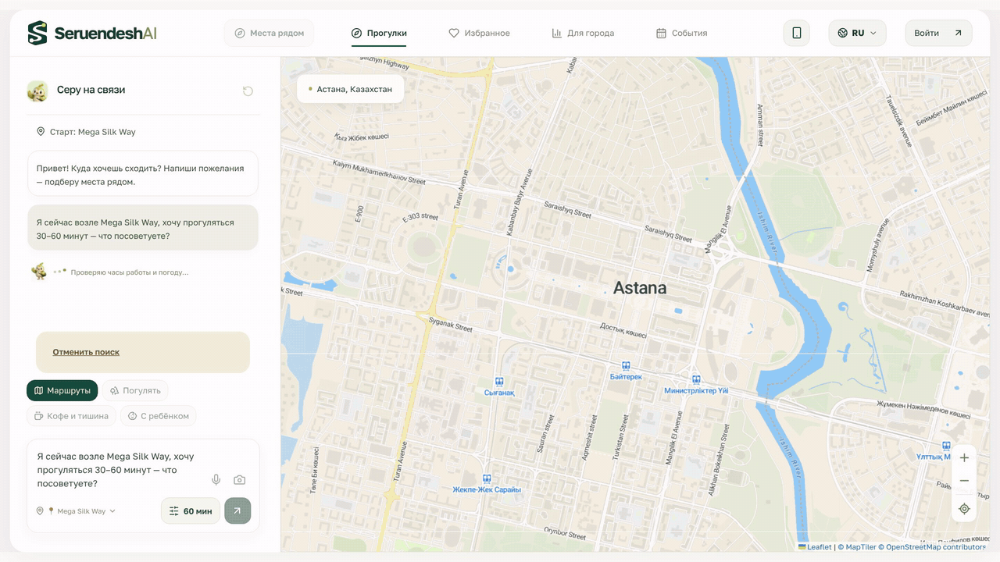
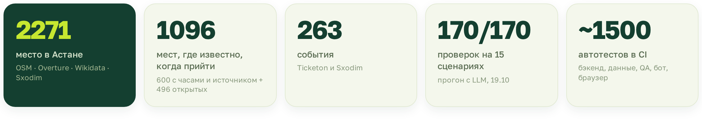
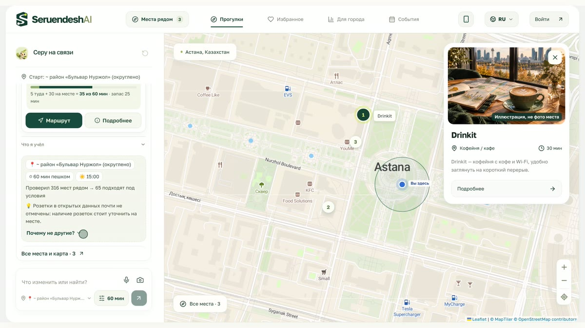
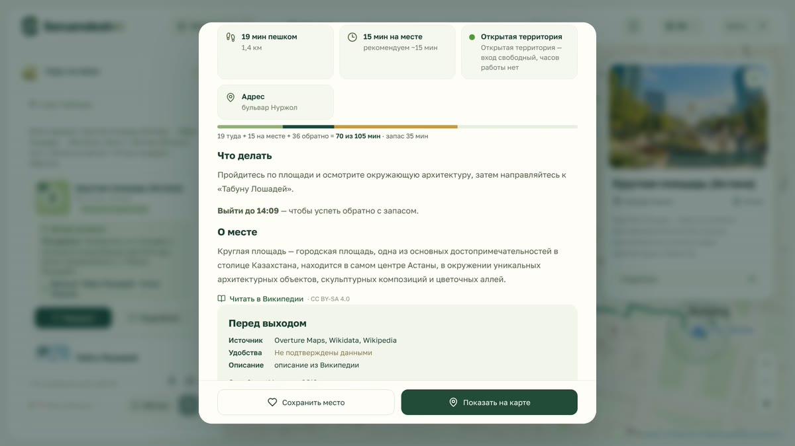
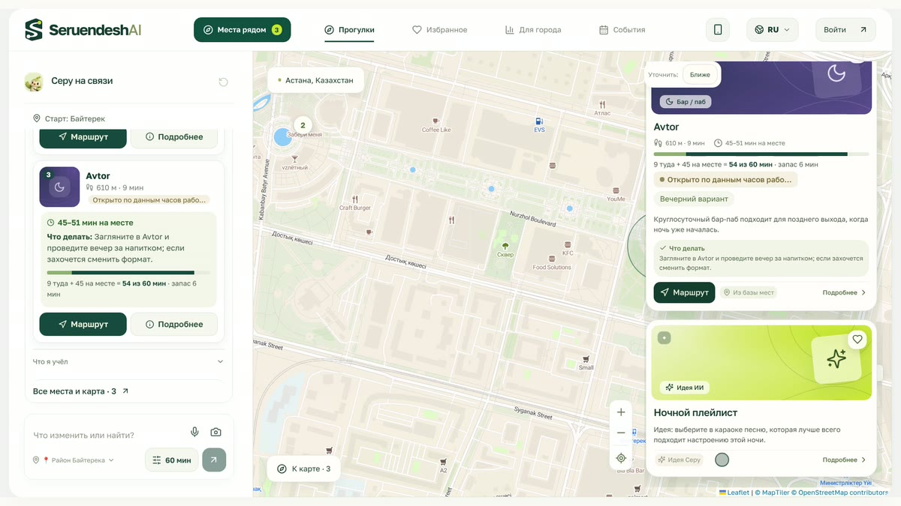
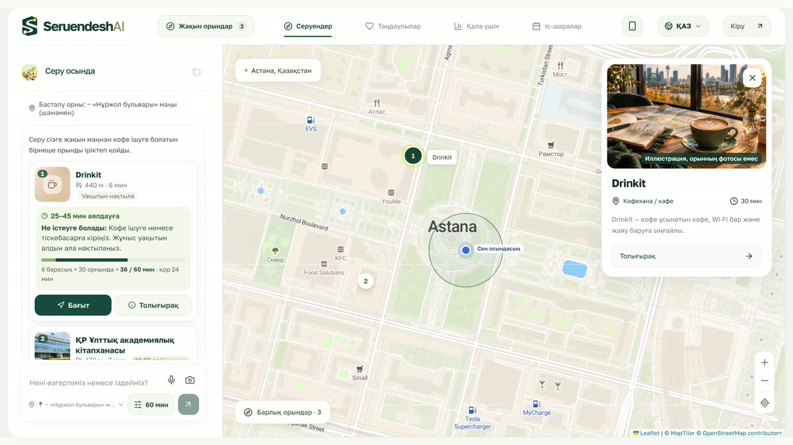
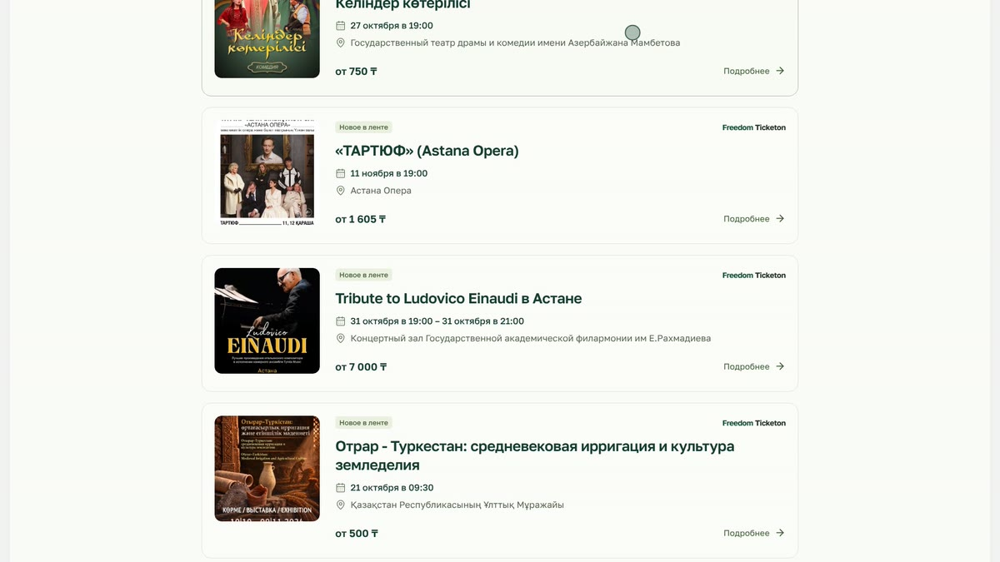
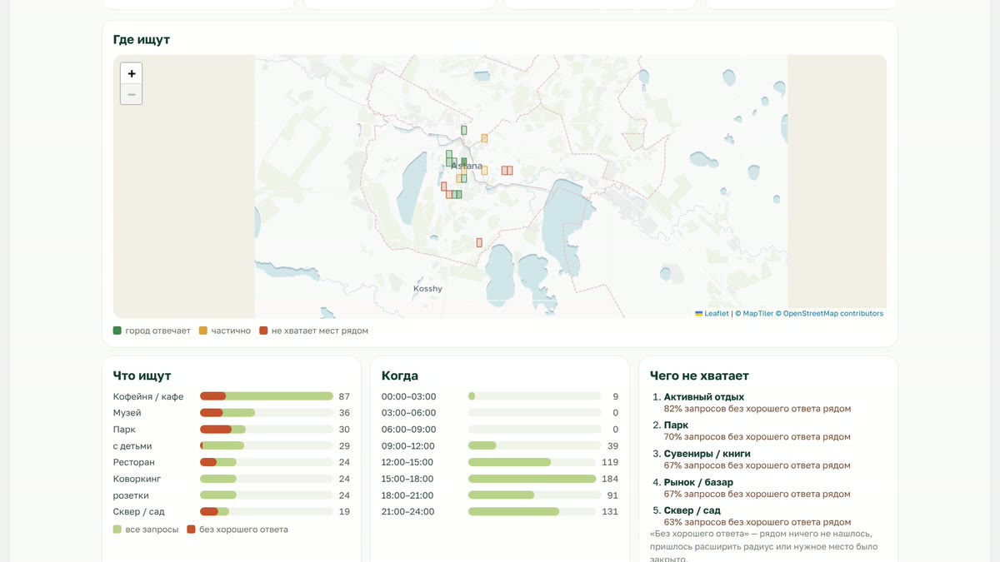
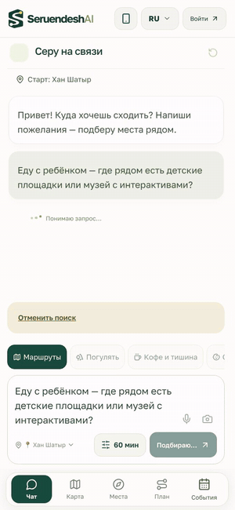
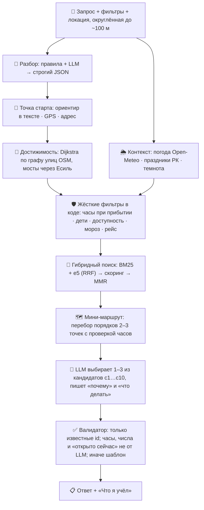

<div align="center">

<a href="https://seruendesh.site"></a>

<br>

<a href="https://seruendesh.site"></a> <a href="https://t.me/SeruendeshAl_bot"></a> <a href="docs/presentation/SeruendeshAI-presentation.pdf"></a>

<a href="https://github.com/Abegerov4/SeruendeshAI/actions/workflows/ci.yml"></a>      

**[Демо](#-демо)** · **[Сценарии](#-попробуй-сценарии-задачи)** · **[Возможности](#-что-умеет-серу)** · **[Как работает](#%EF%B8%8F-как-это-работает)** · **[Доверие](#%EF%B8%8F-доверие-и-приватность)** · **[Для жюри](#-документы-для-жюри)** · **[Запуск](#-быстрый-старт)** · **[Команда](#-команда)**

</div>

<br>


### Привет, я Серу 👋

Я знаю Астану и помогаю решить, **куда пойти прямо сейчас**. Напиши, где ты, сколько у тебя времени и чего хочется, хоть «я у меги, есть час». Я предложу **1–3 места рядом** и проложу мини-маршрут по улицам. Для каждого места скажу:

- 🚶 **сколько идти**: по реальному графу улиц, с мостами через Есиль;
- ⏱ **сколько пробыть** и сколько времени останется в запасе;
- 💬 **почему** оно подходит именно сейчас и **что там делать**;
- 🕐 **часы работы** с источником, датой и степенью уверенности. Никаких «открыто сейчас» наугад;
- 🏷 **откуда это**: «Из базы мест» или «Идея Серу».

Хакатон **Build with AI**, задача 1 от **НИЦ Smart City**: RAG-система, которая в реальном времени подсказывает, куда сходить и что сделать рядом, с учётом локации, времени, погоды и предпочтений.

<br clear="right">

## 🎬 Демо

<p align="center">
  <a href="https://seruendesh.site"></a>
  <br>
  <sub>«Я сейчас возле Mega Silk Way, хочу прогуляться 30–60 минут» → мини-маршрут по улицам, 56 минут из 60 · запись с продакшена</sub>
</p>

<p align="center">
  🌐 <b><a href="https://seruendesh.site">seruendesh.site</a></b> &nbsp;·&nbsp;
  🤖 <b><a href="https://t.me/SeruendeshAl_bot">@SeruendeshAl_bot</a></b> &nbsp;·&nbsp;
  🎥 <b>видео 2:57</b>: <i>ссылка на YouTube появится после загрузки</i>
</p>



## 🧭 Попробуй сценарии задачи

Каждая ссылка сразу открывает запрос на сайте с нужной точкой старта, а ответ считается вживую.

| | Запрос | Что делает Серу | |
|:-:|---|---|:-:|
| 🛍 | «Я сейчас возле Mega Silk Way, хочу прогуляться 30–60 минут» | Мини-маршрут из 2–3 мест, укладывается в бюджет: дорога + время на месте + запас | [**▶ открыть**](https://seruendesh.site/?q=%D0%AF%20%D1%81%D0%B5%D0%B9%D1%87%D0%B0%D1%81%20%D0%B2%D0%BE%D0%B7%D0%BB%D0%B5%20Mega%20Silk%20Way%2C%20%D1%85%D0%BE%D1%87%D1%83%20%D0%BF%D1%80%D0%BE%D0%B3%D1%83%D0%BB%D1%8F%D1%82%D1%8C%D1%81%D1%8F%2030%E2%80%9360%20%D0%BC%D0%B8%D0%BD%D1%83%D1%82%20%E2%80%94%20%D1%87%D1%82%D0%BE%20%D0%BF%D0%BE%D1%81%D0%BE%D0%B2%D0%B5%D1%82%D1%83%D0%B5%D1%82%D0%B5%3F&from=mega_silk_way) |
| ☕ | «Хочу тихое место с кофе и розеткой недалеко от меня» | Кофейни рядом. И честно: розетки в открытых данных почти не размечены, лучше уточнить | [**▶ открыть**](https://seruendesh.site/?q=%D0%A5%D0%BE%D1%87%D1%83%20%D1%82%D0%B8%D1%85%D0%BE%D0%B5%20%D0%BC%D0%B5%D1%81%D1%82%D0%BE%20%D1%81%20%D0%BA%D0%BE%D1%84%D0%B5%20%D0%B8%20%D1%80%D0%BE%D0%B7%D0%B5%D1%82%D0%BA%D0%BE%D0%B9%20%D0%BD%D0%B5%D0%B4%D0%B0%D0%BB%D0%B5%D0%BA%D0%BE%20%D0%BE%D1%82%20%D0%BC%D0%B5%D0%BD%D1%8F&from=baiterek) |
| 🧸 | «Еду с ребёнком — где рядом площадки или музей с интерактивами?» | Только детские места: без «18+», ночных баров и тёмных дворов | [**▶ открыть**](https://seruendesh.site/?q=%D0%95%D0%B4%D1%83%20%D1%81%20%D1%80%D0%B5%D0%B1%D1%91%D0%BD%D0%BA%D0%BE%D0%BC%20%E2%80%94%20%D0%B3%D0%B4%D0%B5%20%D1%80%D1%8F%D0%B4%D0%BE%D0%BC%20%D0%B5%D1%81%D1%82%D1%8C%20%D0%B4%D0%B5%D1%82%D1%81%D0%BA%D0%B8%D0%B5%20%D0%BF%D0%BB%D0%BE%D1%89%D0%B0%D0%B4%D0%BA%D0%B8%20%D0%B8%D0%BB%D0%B8%20%D0%BC%D1%83%D0%B7%D0%B5%D0%B9%20%D1%81%20%D0%B8%D0%BD%D1%82%D0%B5%D1%80%D0%B0%D0%BA%D1%82%D0%B8%D0%B2%D0%B0%D0%BC%D0%B8%3F&from=khan_shatyr) |
| ✈️ | «Я турист, у меня 2 часа перед вылетом» | Закладывает дорогу в аэропорт и пишет «Выйти до …» | [**▶ открыть**](https://seruendesh.site/?q=%D0%AF%20%D1%82%D1%83%D1%80%D0%B8%D1%81%D1%82%2C%20%D1%83%20%D0%BC%D0%B5%D0%BD%D1%8F%202%20%D1%87%D0%B0%D1%81%D0%B0%20%D0%BF%D0%B5%D1%80%D0%B5%D0%B4%20%D0%B2%D1%8B%D0%BB%D0%B5%D1%82%D0%BE%D0%BC%3A%20%D1%87%D1%82%D0%BE%20%D0%BC%D0%BE%D0%B6%D0%BD%D0%BE%20%D0%BF%D0%BE%D1%81%D0%BC%D0%BE%D1%82%D1%80%D0%B5%D1%82%D1%8C%20%D0%BF%D0%BE%D0%B1%D0%BB%D0%B8%D0%B7%D0%BE%D1%81%D1%82%D0%B8%3F&from=baiterek) |
| 🌙 | «Ищу необычную ночную активность на последние пару часов» | Только то, что открыто ночью, плюс «Идея Серу» отдельно от фактов | [**▶ открыть**](https://seruendesh.site/?q=%D0%98%D1%89%D1%83%20%D0%BD%D0%B5%D0%BE%D0%B1%D1%8B%D1%87%D0%BD%D1%83%D1%8E%20%D0%BD%D0%BE%D1%87%D0%BD%D1%83%D1%8E%20%D0%B0%D0%BA%D1%82%D0%B8%D0%B2%D0%BD%D0%BE%D1%81%D1%82%D1%8C%20%D0%BD%D0%B0%20%D0%BF%D0%BE%D1%81%D0%BB%D0%B5%D0%B4%D0%BD%D0%B8%D0%B5%20%D0%BF%D0%B0%D1%80%D1%83%20%D1%87%D0%B0%D1%81%D0%BE%D0%B2&from=baiterek&now=2026-10-24T22:30) |
| 💬 | «я у меги, есть час, хочу кофе и погулять» | Понимает, как в Астане говорят на самом деле: «у меги», «возле шатра», «у шара на ЭКСПО» | [**▶ открыть**](https://seruendesh.site/?q=%D1%8F%20%D1%83%20%D0%BC%D0%B5%D0%B3%D0%B8%2C%20%D0%B5%D1%81%D1%82%D1%8C%20%D1%87%D0%B0%D1%81%2C%20%D1%85%D0%BE%D1%87%D1%83%20%D0%BA%D0%BE%D1%84%D0%B5%20%D0%B8%20%D0%BF%D0%BE%D0%B3%D1%83%D0%BB%D1%8F%D1%82%D1%8C&from=mega_silk_way) |

## ✨ Что умеет Серу

<table>
<tr>
<td width="33%" valign="top"><h3>🗺 Маршрут по улицам</h3>Dijkstra по пешеходному графу OSM (49 тыс. узлов), мосты через Есиль. Мини-маршрут на 2–3 точки с проверкой часов на момент прибытия.</td>
<td width="33%" valign="top"><h3>🕐 Честные часы</h3>У часов есть источник, дата и уверенность. Праздники РК и отметки посетителей «было закрыто» снижают доверие. Нет данных — так и пишем.</td>
<td width="33%" valign="top"><h3>🧠 «Что я учёл»</h3>Локация, бюджет, погода, фильтры, воронка «2271 → рядом → подходят → 3» и ответ на вопрос «почему не другие?».</td>
</tr>
<tr>
<td valign="top"><h3>✨ «Идея Серу»</h3>Творческая мини-активность, например «ночной плейлист в караоке». Помечена отдельно от фактов из базы.</td>
<td valign="top"><h3>🌐 RU · ҚАЗ · EN</h3>Три языка: интерфейс, ответы, названия мест и описания.</td>
<td valign="top"><h3>📱 Телефон и Telegram</h3>PWA с чатом на весь экран, голосовой ввод, режим «где я?» по фото, бот <a href="https://t.me/SeruendeshAl_bot">@SeruendeshAl_bot</a> с маршрутами.</td>
</tr>
<tr>
<td valign="top"><h3>🎟 События</h3>263 события из Ticketon и Sxodim с календарём, архивом и привязкой к местам.</td>
<td valign="top"><h3>🏙 Для города</h3>k-анонимная карта спроса: что ищут, где и когда и где город не отвечает. <a href="https://seruendesh.site/insights">/insights</a></td>
<td valign="top"><h3>🔌 MCP-коннектор</h3>Серу внутри Claude Desktop и других ИИ-клиентов: <a href="docs/MCP.md">docs/MCP.md</a></td>
</tr>
</table>

### Как это выглядит

<table>
<tr>
<td width="50%"><br><sub><b>«Что я учёл»</b>: все использованные данные и «почему не другие»</sub></td>
<td width="50%"><br><sub><b>Турист перед вылетом</b>: «Выйти до 14:09», чтобы успеть с запасом</sub></td>
</tr>
<tr>
<td><br><sub><b>Ночь</b>: открытые сейчас места и «Идея Серу» с отдельной меткой</sub></td>
<td><br><sub><b>Қазақша</b>: ответ, карточки и интерфейс на казахском</sub></td>
</tr>
<tr>
<td><br><sub><b>События</b>: афиша Ticketon и Sxodim рядом с местами</sub></td>
<td><br><sub><b>Для города</b>: спрос и пробелы, только агрегаты от 5 запросов</sub></td>
</tr>
</table>

<table>
<tr>
<td width="300" align="center"></td>
<td valign="middle">

### 📱 В кармане

На телефоне Серу работает как приложение: чат на весь экран, вкладки «Карта», «Места», «План» и «События», установка как PWA.

- **«Где я?» по фото**: сфотографируй, что видишь, и Серу узнает ориентир.
- **Голосом**: продиктуй запрос.
- **Telegram**: те же ответы с фото и кнопками «🗺 Маршрут» и «📍 На карте», `/routes` с готовыми прогулками, `/home` для прогулок «от дома».

<sub>На записи: «Еду с ребёнком — где рядом площадки?» у Хан Шатыра, с мобильной версии продакшена.</sub>

</td>
</tr>
</table>

## ⚙️ Как это работает

Факты дают код и данные, LLM только **выбирает и объясняет**. Всё критичное (часы, расстояния, безопасность) считается и проверяется в коде.



<details>
<summary><b>Подробнее о конвейере</b></summary>

```
запрос + фильтры + локация (~100 м)
  ├─ правила (язык, время, дети, кофе, ночь…)      ┐
  ├─ LLM-разбор gpt-6-luna → строгий JSON          ├─ параллельно
  ├─ погода Open-Meteo, праздники РК, темнота      │
  └─ эмбеддинг запроса (e5-large, локально)        ┘
→ точка старта (ориентир в тексте / GPS / список)
→ достижимость: Dijkstra по пешеходному графу OSM (мосты через Есиль!)
→ жёсткие фильтры в коде: часы при прибытии, дети, доступность, темнота, мороз, дедлайн рейса
→ скоринг: категория + BM25/e5 (RRF), близость, нужды, часы, контекст, популярность → MMR
→ мини-маршрут: перебор порядков 2–3 точек с проверкой часов
→ LLM выбирает 1–3 из карточек c1..c10 и пишет «почему» / «что делать»
→ валидатор: только известные id; числа, часы и «открыто сейчас» вырезаются; иначе шаблон
```

Подробно в [docs/ARCHITECTURE.md](docs/ARCHITECTURE.md). Медиана ответа: 3,4 с в eval и 4,4 с на продакшене.

</details>

## 🛡️ Доверие и приватность

| Принцип | Как устроено |
|---|---|
| 📍 **Локация** | Округляется до ~100 м, не хранится и не передаётся в LLM. Номера домов и координаты в тексте запроса маскируются ещё до ИИ |
| 🕐 **Часы** | «Высокая» уверенность ставится только при источнике, ссылке и дате проверки не старше 180 дней. Старая карточка остаётся «низкой». В праздник без отдельного правила часы «не подтверждены» |
| 🚫 **«Открыто сейчас»** | LLM не может это утверждать: валидатор вырезает такие фразы, статус показывает код |
| 🏷 **Метки** | «Из базы мест» со ссылкой на источник или «Идея Серу» без фактов |
| 📜 **Лицензии** | Только открытые и официальные источники. Sxodim используем по его условиям, со ссылкой на карточку. Данные 2ГИС и Google не используем |
| 🏙 **Аналитика** | Для города только k-анонимные агрегаты: ячейка ≈1 км × 3 часа × тип запроса, значение от 5 запросов |

Подробно в [docs/ETHICS_PRIVACY.md](docs/ETHICS_PRIVACY.md).

## 📊 Данные

**2271 место Астаны** (2328 собрано, дубли и мусор убраны при загрузке). Основу собирает одна команда `make data`: OSM, Overture, Wikidata и Википедия, раз в неделю это повторяет GitHub Actions. Часы с официальных сайтов и из Sxodim добавляют отдельные шаги конвейера (`pipeline.site_hours`, `pipeline.sxodim`), у каждого факта есть ссылка и дата.

| Источник | Что даёт | Лицензия |
|---|---|---|
| OpenStreetMap | основа: ~1500 мест, часы, доступность, кухня, граф улиц | ODbL |
| Overture Maps | +~990 мест, сайты и телефоны | CDLA-Permissive-2.0 / Apache-2.0 / CC0 |
| Wikidata · Wikipedia | достопримечательности, названия RU/KK/EN, описания со ссылкой | CC0 · CC BY-SA 4.0 |
| Сайты мест и сетей, CityPass | часы работы с цитатой, источником и датой | факты и ссылка |
| Sxodim | часы для 140 мест и 42 новых места | некоммерчески, со ссылкой на карточку |
| Ticketon · Sxodim | 263 события | факты и ссылка |
| Open-Meteo | погода в момент запроса | CC BY 4.0 |

Время доступа известно для **1096 мест (48%)**: у 600 есть часы с источником, ещё 496 — открытые территории (скверы, площадки, памятники). У остальных Серу честно пишет «часы неизвестны». Подробно в [docs/DATA.md](docs/DATA.md).

## 📚 Документы для жюри

| Требование задачи | Документ |
|---|---|
| 1. Концепция продукта, аудитория, сценарии, бизнес, риски, план | [docs/CONCEPT.md](docs/CONCEPT.md) |
| 2. Демо / прототип | **https://seruendesh.site**: API + фронтенд в [`frontend/`](frontend/), удобно и с телефона (резерв: https://seruendesh-production.up.railway.app) |
| 3. Описание RAG-подхода | [docs/ARCHITECTURE.md](docs/ARCHITECTURE.md) |
| 4. Тестовые сценарии и ограничения | [docs/TEST_SCENARIOS.md](docs/TEST_SCENARIOS.md), [docs/EVAL_RESULTS.md](docs/EVAL_RESULTS.md) |
| 5. Презентация | [PDF, 14 слайдов](docs/presentation/SeruendeshAI-presentation.pdf) · [PPTX](docs/presentation/SeruendeshAI-presentation.pptx) · план и сценарий демо в [docs/PRESENTATION.md](docs/PRESENTATION.md) |
| Демо-видео (YouTube) | _ссылка появится после загрузки_ |
| 6. Этика и приватность | [docs/ETHICS_PRIVACY.md](docs/ETHICS_PRIVACY.md) |
| Сбор данных (автоматизирован) | [docs/DATA.md](docs/DATA.md) |
| Как выбирали стек | [docs/RESEARCH.md](docs/RESEARCH.md) |
| API-контракт | [docs/API.md](docs/API.md), [OpenAPI](docs/api/openapi.json), [примеры ответов](docs/api/examples/) |
| Для города: City Insights | https://seruendesh.site/insights и открытые агрегаты `GET /api/insights` |
| Telegram-бот | [@SeruendeshAl_bot](https://t.me/SeruendeshAl_bot), работает внутри сайта по webhook ([bot/README.md](bot/README.md)) |
| Готовые маршруты и «от дома» | «🗺 Маршруты» в чате и `POST /api/routes/ideas`; «🏠 Дом» и фразы «от дома / рядом с домом» |
| MCP-коннектор | [docs/MCP.md](docs/MCP.md), эндпоинт `https://seruendesh.site/connector/mcp` |

### Качество

| Проверка | Результат |
|---|---|
| LLM-прогон: 15 сценариев × 12 автоматических проверок (19.10) | **170 / 170** ([EVAL_RESULTS](docs/EVAL_RESULTS.md)) |
| Нейтральный ИИ-судья | 20 из 23 ответов без неподтверждённых утверждений |
| Автотесты в CI на каждый push | **~1500**: бэкенд 698 · данные 361 · QA 374 · поиск 7 · бот 12 · фронтенд 30 + 31 в браузере |

Как тестируем, описано в [docs/QA.md](docs/QA.md).

## 🚀 Быстрый старт

Нужны Python ≥ 3.12 и [uv](https://docs.astral.sh/uv/). Ключ OpenAI необязателен: без него работает шаблонный режим.

```bash
cp .env.example .env            # вписать OPENAI_API_KEY
cd backend
uv sync                         # зависимости рантайма + dev
uv run uvicorn app.main:app --port 8000
```

- Swagger: http://localhost:8000/docs · проверка: `curl localhost:8000/api/health`
- Первый запуск один раз скачивает модель эмбеддингов (~560 МБ). Без неё: `EMBED_MODEL=off`, тогда поиск только по BM25 и ~0,3 ГБ RAM.

```bash
curl -s localhost:8000/api/recommend -H 'content-type: application/json' -d '{
  "query": "Я сейчас возле Mega Silk Way, хочу прогуляться 30–60 минут — что посоветуете?",
  "lang": "ru"
}' | python -m json.tool
```

Фронтенд (React + Vite) лежит в `frontend/`, инструкции в [frontend/README.md](frontend/README.md); укажите `VITE_API_URL=http://localhost:8000`. **Docker:** `docker compose up --build` из корня, один контейнер отдаёт и API, и собранный фронт.

<details>
<summary><b>Команды, хостинг и фото карточек</b></summary>

```bash
make test        # тесты бэкенда (без ключа)
make eval        # 15 сценариев в шаблонном режиме (backend/eval)
make eval-llm    # те же сценарии с LLM + LLM-as-judge
make data        # полный автоматический сбор данных: fetch → build → graph → embed → events
make contract    # выгрузить OpenAPI и примеры ответов для фронтенда
make deploy      # выложить последний коммит ветки ayat на Railway
```

Хостинг: Railway (проект `seruendesh`) собирает корневой `Dockerfile` (`railway.json`, healthcheck `/api/health`); ветки `main` и `ayat` содержат одно и то же приложение.

Фото карточек в SeaweedFS/S3: [запуск, загрузка и резервное копирование](docs/CARD_PHOTOS.md).

</details>

<details>
<summary><b>Структура репозитория</b></summary>

```
backend/          продукт: FastAPI (API, MCP-коннектор, режим по фото, аккаунты) + раздача фронтенда
  app/            поиск, ранжирование, маршруты, LLM, валидатор, защиты
  pipeline/       сбор снимка, который отдаёт API (OSM, Overture, Wikidata, Wikipedia, CityPass, Sxodim, фото, граф, эмбеддинги)
  eval/           15 сценариев и харнесс оценки (проверки + LLM-as-judge)
  tests/          698 тестов бэкенда
frontend/         интерфейс (React + Vite, маскот Серу)
bot/              Telegram-бот, тонкий клиент API
data/processed/   снимок API (pois.jsonl, газеттир, граф, эмбеддинги, манифест) и каталог команды
data/             каталог команды на 14 тыс. мест с происхождением, ревью и проверками
rag/              модуль гибридного поиска команды (BM25 + Chroma) и его оценка
tests/            QA-набор команды: контракт, безопасность, golden set, данные, RAG
eval/             golden set на 64 сценария, судья, метрики, шлюз готовности
docs/             концепция, архитектура, данные, этика, сценарии, презентация, API, MCP
team/             роли и контракты команды
```

Как сведены ветки и что взято из каждой, описано в [docs/INTEGRATION.md](docs/INTEGRATION.md).

</details>

## ⚠️ Ограничения

Честно описаны в [docs/TEST_SCENARIOS.md](docs/TEST_SCENARIOS.md#ограничения). Главные:

- часы работы с источником есть у ~26% мест, ещё ~22% — открытые территории;
- рейтингов в открытых данных нет;
- розетки и «тишина» почти не размечены;
- пешеходный граф покрывает центр, ЭКСПО и НУ, для окраин расстояние оценивается;
- время на машине — эвристика, без пробок в реальном времени.

## 👥 Команда

**YeahGrinders** · GDG Build with AI · Астана

| Кто | Что делал |
|---|---|
| **Ayat** | бэкенд RAG, конвейер данных, оценка, деплой, сведение веток |
| **Aldiyar** ([@Abegerov4](https://github.com/Abegerov4)) | интеграция бэкенда, защита от инъекций и маскирование ПД, Telegram-бот, качество рекомендаций, трассировка Langfuse, данные Sxodim, CI и еженедельное обновление данных |
| **Denis** | модуль гибридного поиска (`rag/`), обогащение данных из Википедии, избранное |
| **Aslan** | QA-набор (`tests/`, `eval/`), каталог на 14 тыс. мест с происхождением и ревью (`data/`), лента событий, аудит бэкенда на 44 пункта |
| **Codex** | интерфейс и маскот Серу |

<details>
<summary><b>🇬🇧 English summary</b></summary>

**SeruendeshAI** is a RAG walking assistant for Astana, Kazakhstan, built for the *Build with AI* hackathon (task 1, Smart City research centre). Tell **Seru**, a little green bird, where you are, how much time you have and what you feel like. Seru suggests 1–3 places nearby with a street-graph mini-route, time on site, the reason it fits right now and what to do there. Opening hours carry a source, a date and a confidence level, and the AI never claims "open now". Data: 2,271 places from OpenStreetMap, Overture, Wikidata/Wikipedia and official sites, plus 263 events. The interface works in Russian, Kazakh and English. The user's location is rounded to ~100 m and never sent to the LLM. Live at **[seruendesh.site](https://seruendesh.site)** and in Telegram as [@SeruendeshAl_bot](https://t.me/SeruendeshAl_bot).

</details>

---

<div align="center">


<sub>© OpenStreetMap contributors (ODbL) · Overture Maps Foundation (CDLA-Permissive-2.0 / Apache-2.0 / CC0) · Wikidata (CC0) · Wikipedia (CC BY-SA 4.0, ссылки в карточках) · Open-Meteo (CC BY 4.0) · события: Ticketon, Sxodim · CityPass Astana и Sxodim (факты и ссылка)</sub>

<sub>Сделано с 💚 в Астане</sub>

</div>
